# Vibin' App

[](https://translate.codeberg.org/engage/vibin/)

This is the client application for [Vibin'](https://codeberg.org/mickkc/vibin), a self-hosted music streaming service.

Please note that this project, just like the server, is currently in beta and still in development.

|  |  |  |  |  |
|---------------------------------------------------------------------|---------------------------------------------------------------------|---------------------------------------------------------------------|---------------------------------------------------------------------|---------------------------------------------------------------------|

# Screenshots

|                      **Track view**                       |            **Track view with lyrics sidebar**             |
|:---------------------------------------------------------:|:---------------------------------------------------------:|
|                      |   |
|                      **Album view**                       |                      **Artist view**                      |
|                      |                    |
|                     **Playlist view**                     |           **Playlist collaboration selection**            |
|               |  |
|                    **Track overview**                     |                  **"Now playing" view**                   |
|                 |            |
|                 **Track metadata search**                 |                     **Lyrics search**                     |
|  |         |

# Themes

|                          **Material 3 Dark**                          |                      **Material 3 Light**                       |
|:---------------------------------------------------------------------:|:---------------------------------------------------------------:|
|      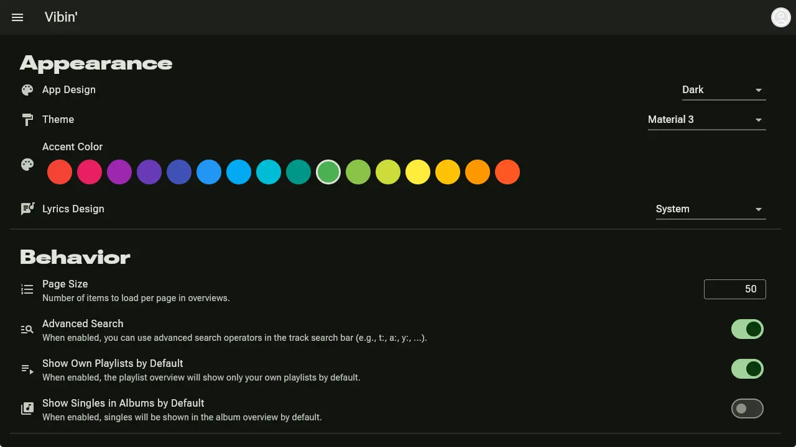       |  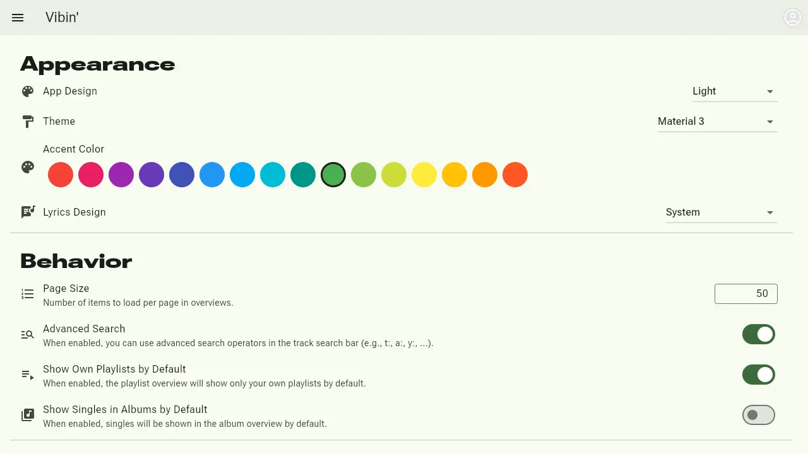   |
|                           **Gruvbox Dark**                            |                        **Gruvbox Light**                        |
|         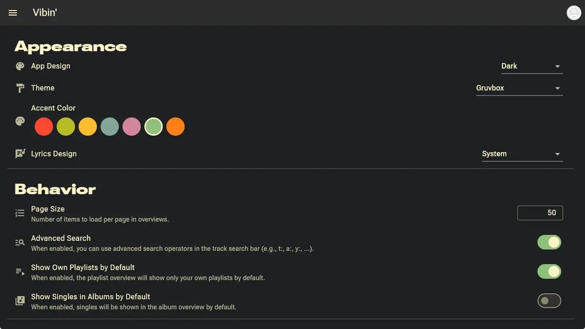         |     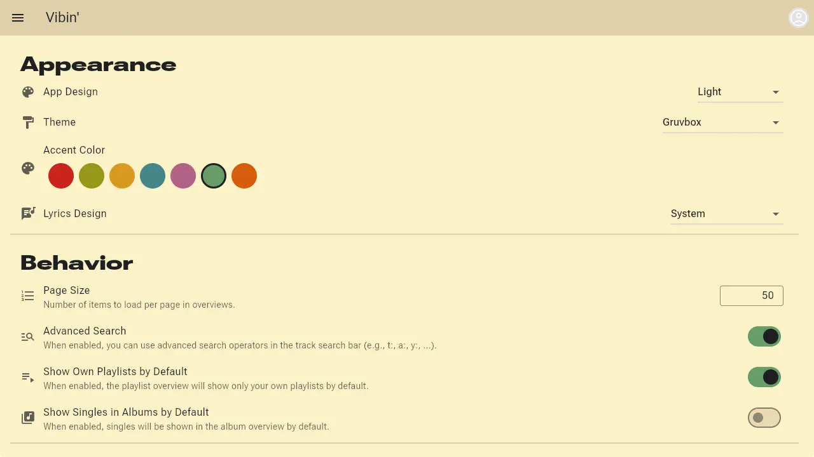     |
|                         **Catppuccin Latte**                          |                      **Catppuccin Frappé**                      |
|     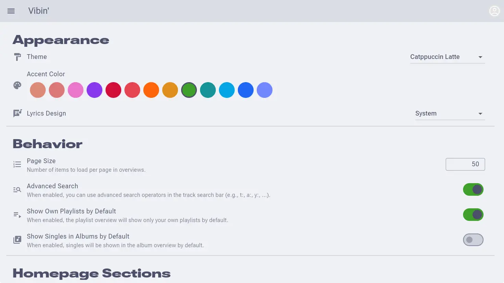     | 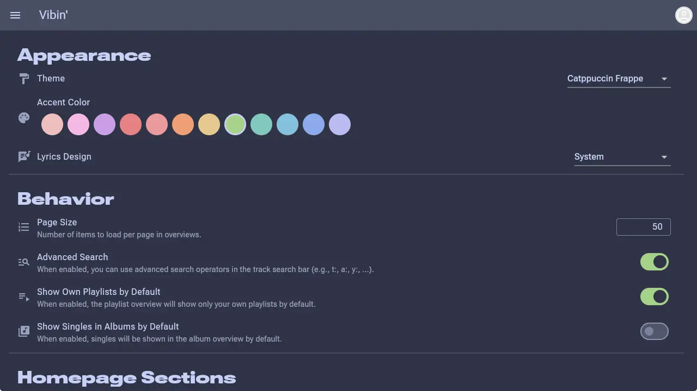 |
|                       **Catppuccin Macchiato**                        |                      **Catppuccin Mocha**                       |
| 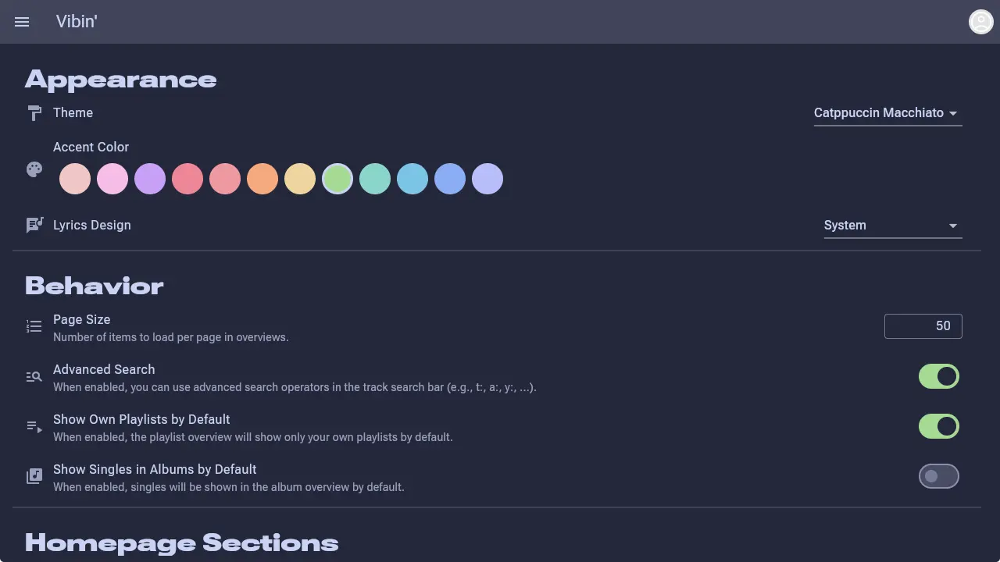 |  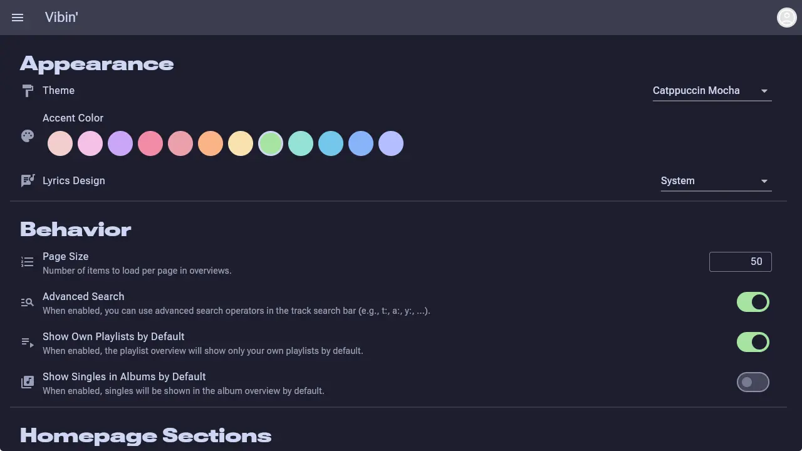  |
|                           **Dracular Dark**                           |                       **Dracular Light**                        |
|        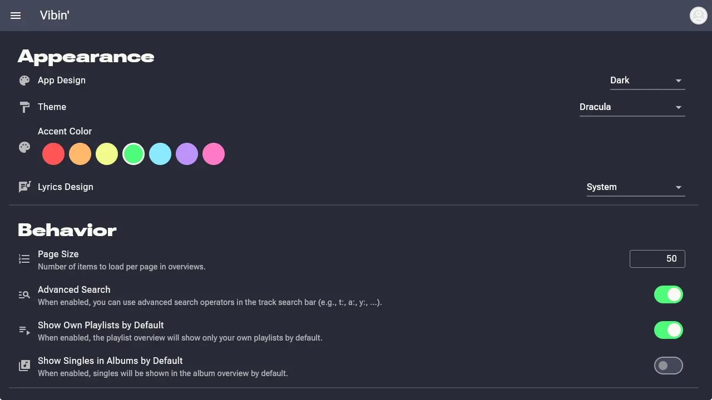        |    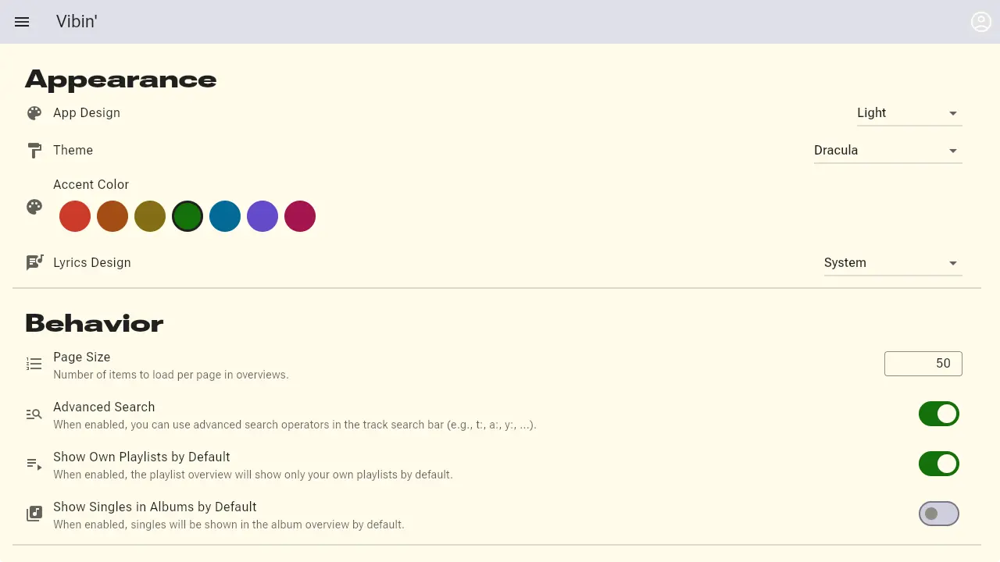    |
|                             **Nord Dark**                             |                         **Nord Light**                          |
|          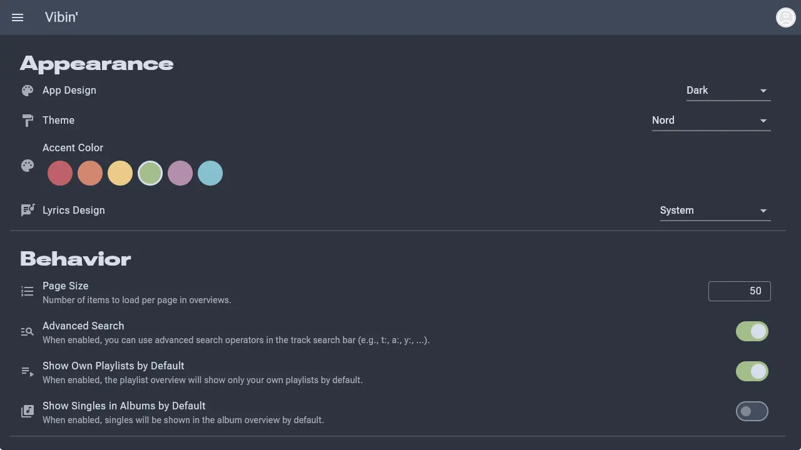          |      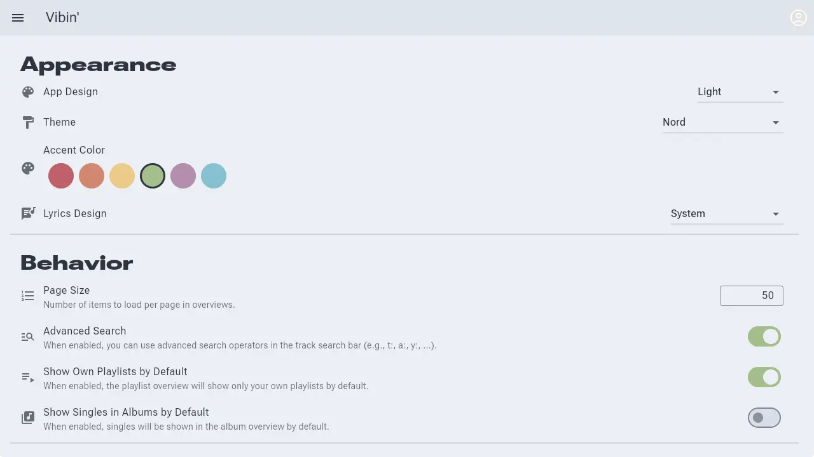      |
|                          **Solarized Dark**                           |                       **Solarized Light**                       |
|       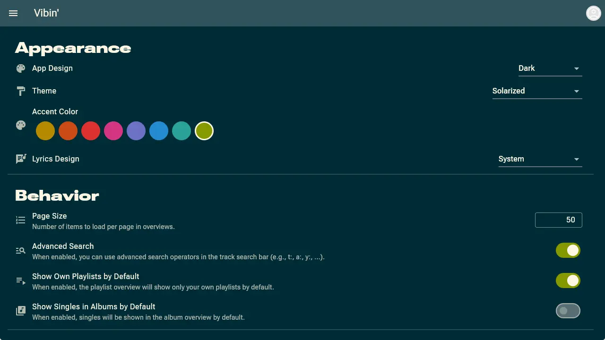       |   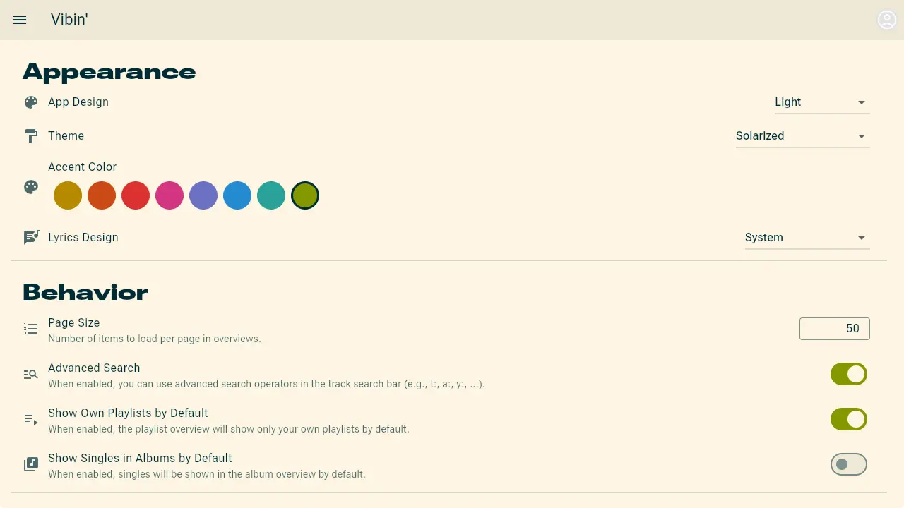   |

# Feature Checklist

- [x] Login / Logout
- [ ] Registration (?)
- [x] Media Token for tracks & covers
- [x] Streaming tracks
- [ ] Verify background playback works everywhere
- [ ] Test on Platforms
  - [x] Linux
  - [x] Android
  - [ ] iOS
  - [ ] macOS
  - [ ] Windows
  - [x] Web
- [x] Dark/Light mode
- [x] ~~Dynamic color scheme~~ (Dropped in favor of manual color schemes due to complexity)
- [x] Manual color schemes
- [x] Player controls
    - [x] Play/Pause
    - [x] Next/Previous track
    - [x] Seek
    - [x] Shuffle
    - [x] Repeat
    - [x] Volume control
    - [x] Playback speed
- [x] Linux DBus media player integration
- [x] Discord presence integration
- [x] Currently playing view
- [ ] Queue
    - [x] View queue
    - [x] Reorder queue
    - [x] Remove tracks from queue
    - [ ] Add random / recommended tracks to queue
    - [ ] Save queue as playlist
- [x] Homepage
  - [x] Recommended items
  - [x] Recently played items
  - [x] Newly added items
  - [x] Popular items
  - [x] Random tracks
  - [x] Top monthly tracks
  - [x] Top monthly artists
  - [x] Random playlists
- [x] Browse library
  - [x] Albums
  - [x] Artists
  - [x] Playlists
  - [x] Tracks
  - [x] Tags
- [ ] Search
  - [x] Albums
  - [x] Artists
  - [x] Playlists
  - [x] Tracks
  - [x] Tags
  - [ ] Global search
- [x] Edit
  - [x] Albums
  - [x] Artists
  - [x] Playlists
  - [x] Tracks
  - [x] Tags
- [x] Create 
  - [x] Playlists
  - [x] Tags
- [x] Delete
    - [x] Playlists
    - [x] Tracks
    - [x] Albums
    - [x] Artists
    - [x] Tags
- [x] Upload tracks
- [x] Download tracks
- [ ] Settings
  - [ ] App settings
    - [x] Theme (dark/light)
    - [x] Page size
    - [x] Advanced track search
    - [x] Show own playlists by default
    - [x] Hide singles in albums by default
    - [x] Enable/disable/reorder homepage sections
    - [x] Preferred metadata provider
    - [x] Blocked tags
    - [x] Blocked artists
    - [ ] Block explicit content
    - [x] Accent color
    - [x] Lyric design
    - [x] D-Bus settings
    - [x] Embed images as base64
    - [x] Image quality
    - [ ] ...
  - [ ] Server settings
    - [ ] ...
- [x] Playlist collaboration
- [x] User management
  - [x] View users
  - [x] Edit users
  - [x] Create users
  - [x] Delete users
- [x] User view
  - [x] Top tracks (when permitted by user)
  - [x] Top artists (when permitted by user)
  - [x] Recent activity (when permitted by user)
  - [x] Playlists (only publicly shared)
  - [x] Uploaded tracks (when permitted by user)
- [x] Sessions management
- [x] Permissions management
- [x] Lyrics
- [x] HTML Widgets for embedding
- [x] Embed web version into server
- [ ] Clean up Code
- [x] Better error handling
- [ ] Write tests

---

## License

This project is licensed under the **[GNU General Public License v3.0](LICENSE)** (GPLv3).

```
Vibin - Self-hosted music streaming server
Copyright (C) 2026 mickkc

This program is free software: you can redistribute it and/or modify
it under the terms of the GNU General Public License as published by
the Free Software Foundation, either version 3 of the License, or
(at your option) any later version.
```
