# Vibin' App

[](https://translate.codeberg.org/engage/vibin/)

This is the client application for [Vibin'](https://codeberg.org/mickkc/vibin), a self-hosted music streaming service.

Please note that this project, just like the server, is currently in beta and still in development.

|  | 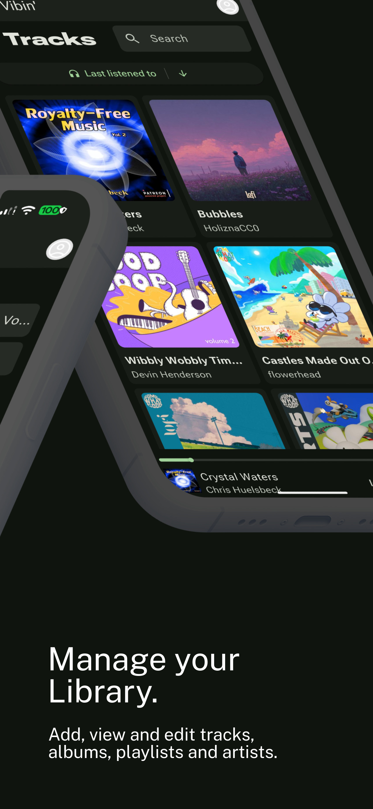 | 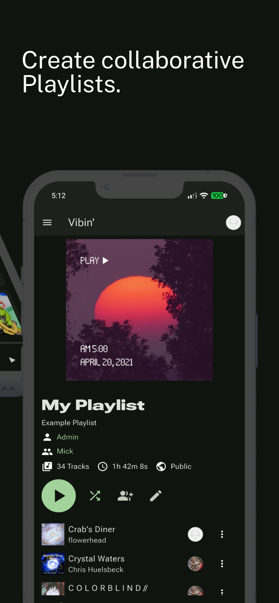 | 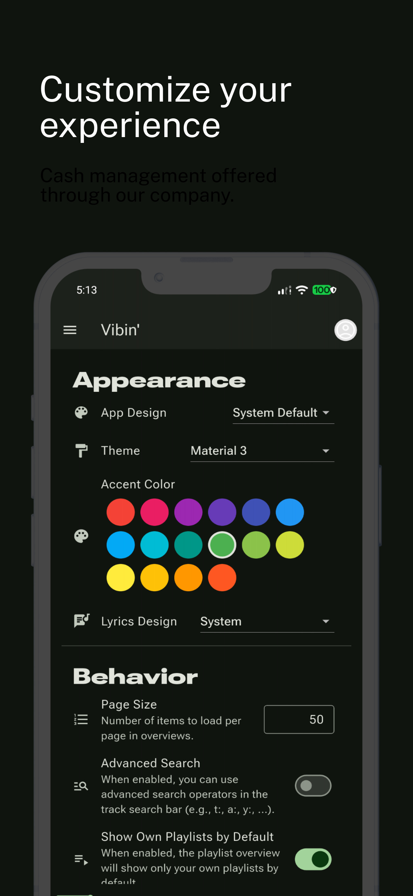 | 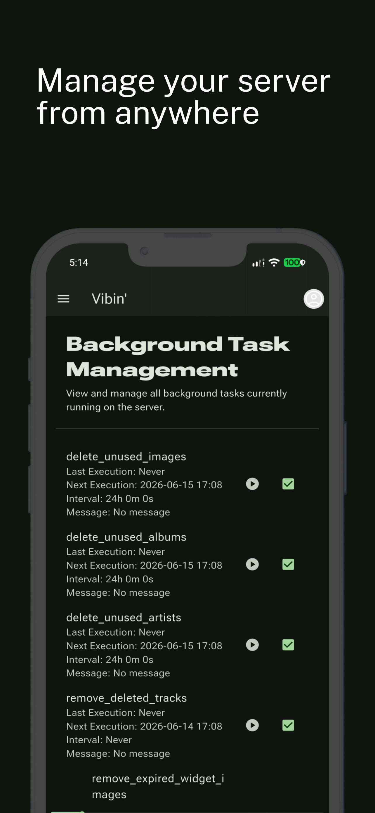 |
|---------------------------------------------------------------------|---------------------------------------------------------------------|---------------------------------------------------------------------|---------------------------------------------------------------------|---------------------------------------------------------------------|

# Screenshots

|                      **Track view**                       |            **Track view with lyrics sidebar**             |
|:---------------------------------------------------------:|:---------------------------------------------------------:|
|           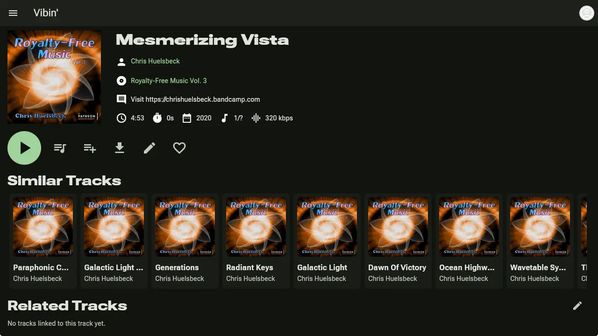           | 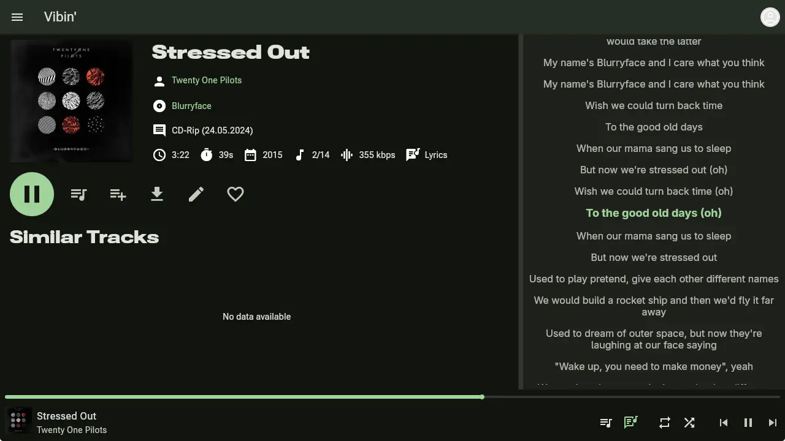  |
|                      **Album view**                       |                      **Artist view**                      |
|           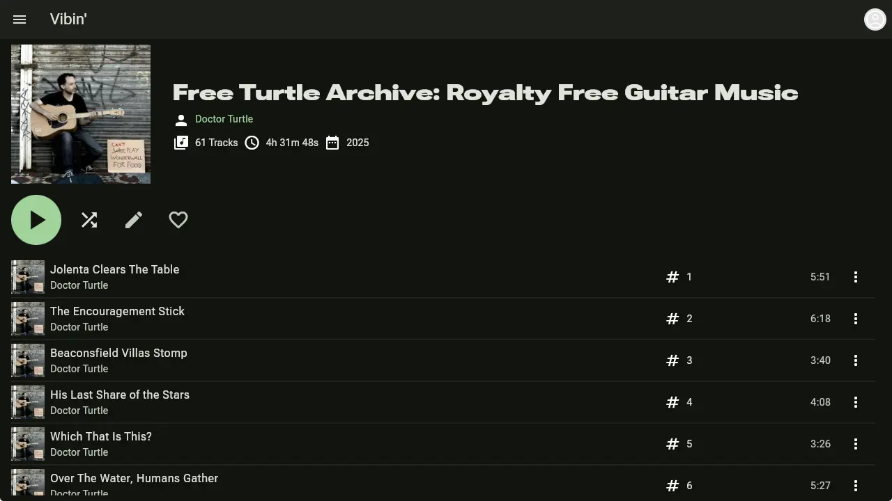           |          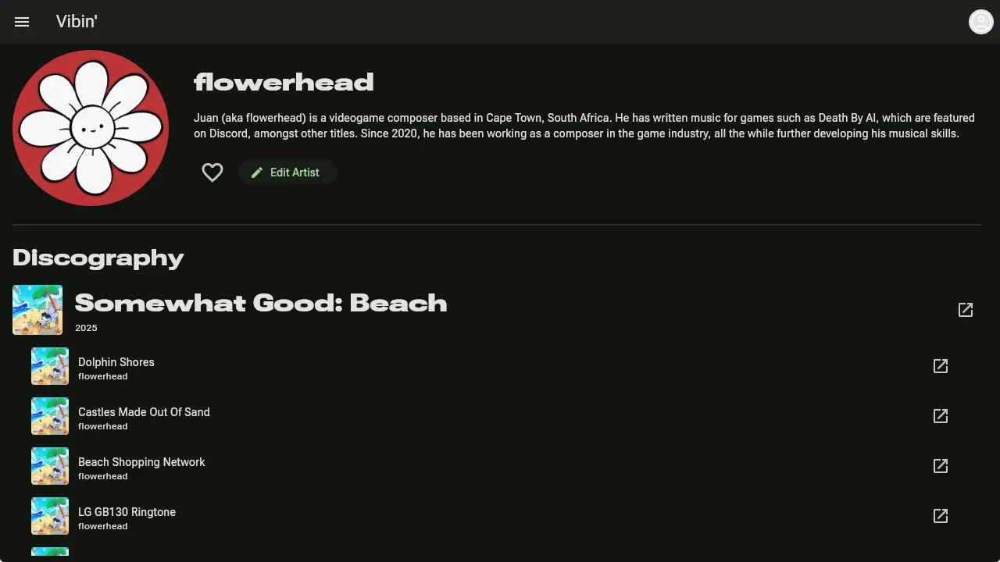          |
|                     **Playlist view**                     |           **Playlist collaboration selection**            |
|        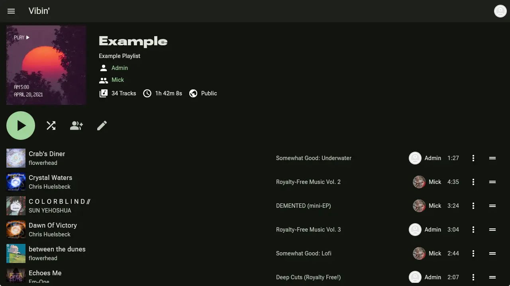        | 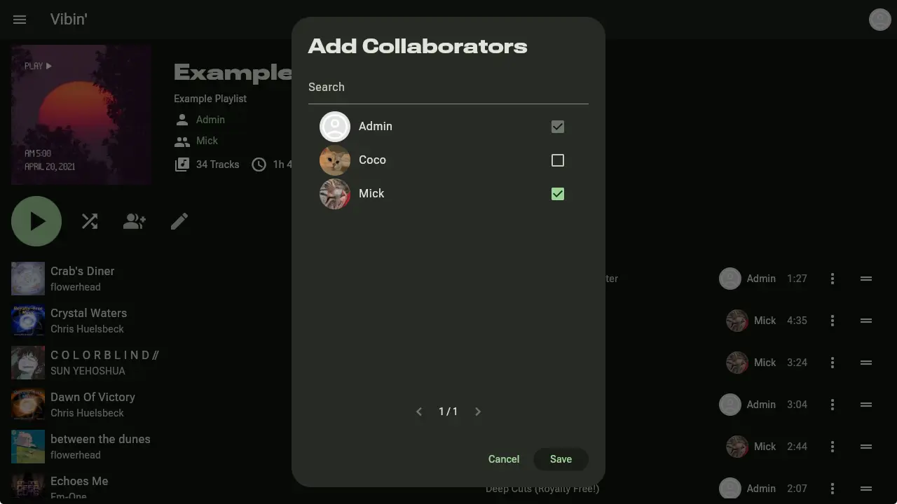 |
|                    **Track overview**                     |                  **"Now playing" view**                   |
|        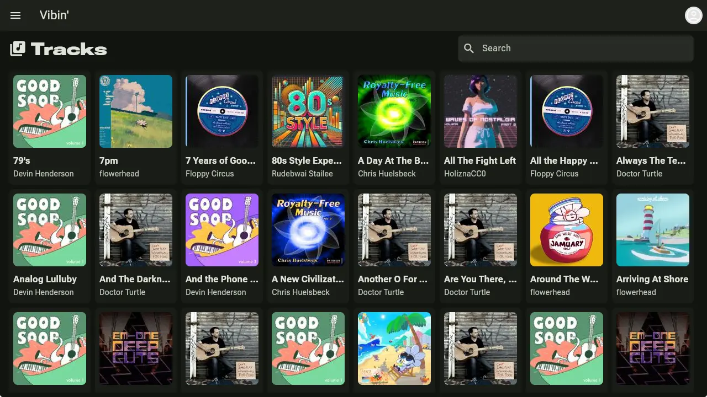         |    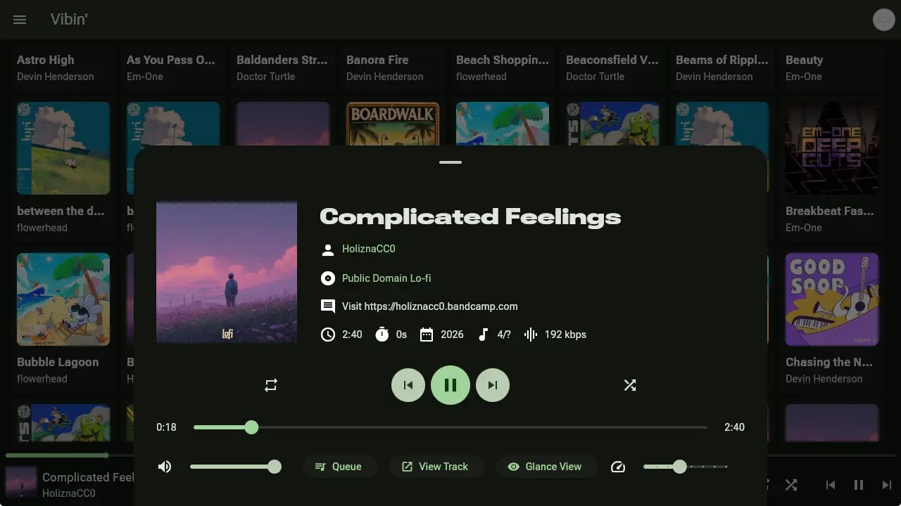    |
|                 **Track metadata search**                 |                     **Lyrics search**                     |
| 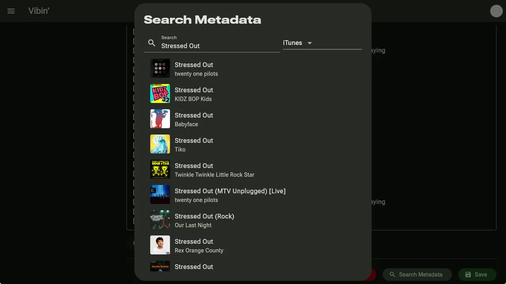 |    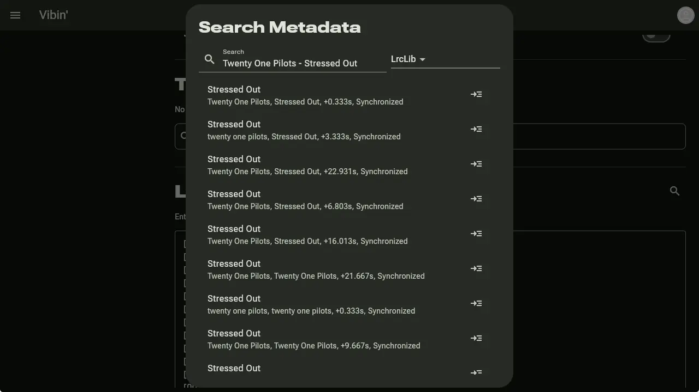     |

# Getting started (Development)

<details open>
<summary>🐧 (Arch) Linux</summary>

> [!NOTE]
> The following commands and package names are intended to be used on Arch Linux,
> they may differ for other distributions.

1. Install [fvm](https://fvm.app/):
    ```bash
    sudo pacman -S fvm
    ```
2. Install the dependencies `cmake`, `ninja`, `clang`, `pkgconf`, `gtk3` and `mpv`:
    ```bash
    sudo pacman -S cmake ninja clang pkgconf gtk3 mpv
    ```
3. Clone this repo:
    ```bash
    git clone https://codeberg.org/mickkc/vibin-app.git
    cd vibin-app
    ```
4. Download packages:
   ```bash
   fvm flutter pub get
   ```
   > [!NOTE]
   > This will automatically install the flutter version configured in [.fvmrc](.fvmrc).
5. Generate the API client and serialization code:
   ```bash
   fvm flutter pub run build_runner build --delete-conflicting-outputs
   ```
6. Run the application:
   ```bash
   fvm flutter run -d linux
   ```

> [!TIP]
> If you use IntelliJ IDEA or Android Studio with the [Flutter](https://plugins.jetbrains.com/plugin/9212-flutter) and
> [Dart](https://plugins.jetbrains.com/plugin/6351-dart) plugins, the SDK paths should automatically be set.
>
> If not, you can set them manually:
> 1. In `File | Settings | Languages & Frameworks | Flutter`: Set Flutter SDK Path to `/path/to/vibin-app/.fvm/flutter_sdk`.
> 2. In `File | Settings | Languages & Frameworks | Dart`: Enable Dart support, check the "vibin-app" module (usually at
>    the very bottom) and set the Dart SDK Path to `/path/to/vibin-app/.fvm/flutter_sdk/bin/cache/dart-sdk`.

> [!NOTE]
> If you get an error saying that the keyring couldn't be unlocked, you may need to install one:
> ```bash
> sudo pacman -S gnome-keyring
> ```
> This is just an example, you could also use `kwallet`, or others.
   
</details>

<!-- TODO: Windows -->
<!-- TODO: macOS -->


---

## Credits

Thank you to everyone who contributed to Vibin'! ❤️

- @Vistaus - Dutch translation
- @WreckingBANG, @blorg - Testing, Issue reporting

---

## License

This project is licensed under the **[GNU General Public License v3.0](LICENSE)** (GPLv3).

```
Vibin - Self-hosted music streaming server
Copyright (C) 2026 mickkc

This program is free software: you can redistribute it and/or modify
it under the terms of the GNU General Public License as published by
the Free Software Foundation, either version 3 of the License, or
(at your option) any later version.
```
